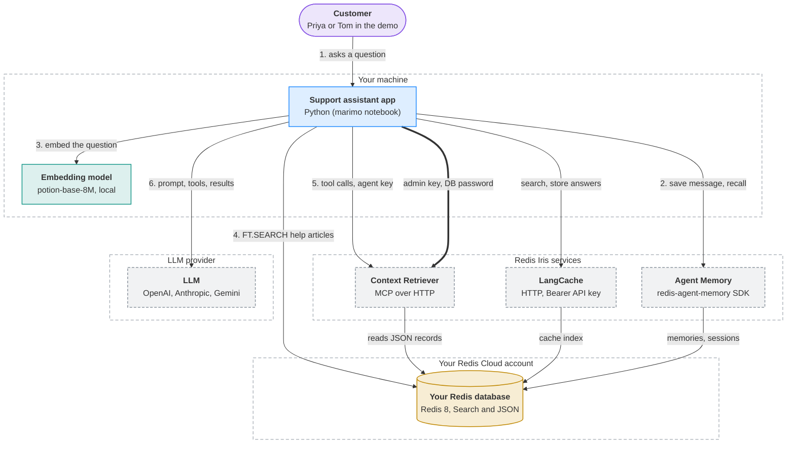

# Redis Iris in practice

One [marimo](https://marimo.io) notebook. Cairn Outfitters, a made-up outdoor-gear shop, is launching an AI support assistant, and you build it with [Redis Iris](https://redis.io/iris/) in four chapters: Search, semantic caching, context retrieval, and agent memory.

For more Iris demos, see [redis/redis-iris-demos](https://github.com/redis/redis-iris-demos).

<!-- visualizer:start path=docs/architecture/architecture.json hash=363764facfc3 -->
## Architecture



Components, data flows and where state lives: [docs/architecture/ARCHITECTURE.md](docs/architecture/ARCHITECTURE.md)
<!-- visualizer:end -->

## Prerequisites

You need:

- A Redis 8 database with Search and JSON. We recommend a free [Redis Cloud](https://cloud.redis.io) database.
- An API key from OpenAI, Anthropic, or Google AI Studio, set as `LLM_API_KEY` in `.env`. The notebook uses OpenAI's `gpt-4o-mini`. To use Claude or Gemini, set `AI_MODEL` in the notebook's first column to a `claude-…` or `gemini-…` model.
- An embedding model (the [intro notebook](./notebooks/learn_iris_101.py) fetches a small model from HuggingFace).

[Redis Search](https://redis.io/docs/latest/develop/ai/search-and-query/) runs in your database. You'll also set up three services, each with its own key in `.env`:

- [Redis LangCache](https://redis.io/docs/latest/develop/ai/context-engine/langcache/): for semantic caching
- [Redis Context Retriever](https://redis.io/docs/latest/develop/ai/context-engine/context-retriever/): for centralized, fresh context from Redis
- [Redis Agent Memory](https://redis.io/docs/latest/develop/ai/context-engine/agent-memory/): an LLM-agnostic short-term and long-term memory layer

## Getting Started

1. Clone the repository and open the folder:

   ```sh
   git clone https://github.com/boonhapus/redis-iris-walkthrough
   cd redis-iris-walkthrough
   ```

2. Copy the sample settings file, then open `.env`, uncomment every variable, and fill each one in. The comments in the file say where to find each value in the Redis Cloud console.

   ```sh
   cp .env.example .env
   ```

3. Start the notebook with [uv](https://docs.astral.sh/uv/), which installs Python and the dependencies on the first run. That run also downloads the embedding model, about 30 MB.

   ```sh
   uv run --env-file .env marimo edit --port 2718 --watch notebooks/learn_iris_101.py
   ```

   `--env-file .env` loads your settings into the server, `--port 2718` serves the notebook at `http://localhost:2718`, and `--watch` reloads the notebook when you save it in another editor. marimo opens it in your browser.

   No uv? Use pip with Python 3.12 or 3.13 (3.14 is not supported yet). Create a virtual environment, install the project into it, and start marimo from there:

   ```sh
   python -m venv .venv
   source .venv/bin/activate   # on Windows: .venv\Scripts\activate
   pip install -e .
   marimo edit notebooks/learn_iris_101.py
   ```

Fill in your .env prior to launching, or press **Restart kernel** in the first column.

## How to use the notebook

- **Read left to right.** Each column is a chapter. Scroll down a column, then move to the next one.
- **Yellow buttons do the work.** Create, Ask, Seed, and Refresh send real requests. Red buttons delete.
- **"Try it" boxes tell you what to do next.** Sliders and dropdowns update their results as soon as you change them.
- **Hidden cells only run requests or draw tables.** Click the faded first line of code to see the whole cell. The functions each chapter builds stay visible.
- **Changed `.env`?** Press **Restart kernel** in the first column.
- **Things expire.** Help articles and Chapter 3's records last an hour, and cached answers 15 minutes. If a chapter says it found nothing, press **Create** again.
- **When you're done,** press **Clean up everything** at the end of Chapter 4. The Context Retriever surface holds your database password and never expires.

---

## Want to explore with an Agent?

The chapters are one path through the notebook. This notebook includes a way to coordinate with an AI Agent if you want to explore ad-hoc using [marimo-pair](.agents/skills/marimo-pair/SKILL.md).

- Ask why a result came out the way it did?
- Try a question the chapter never asks.
- Explain the notebook controls.

Point your agent at the downloaded repository and continue to explore.

```text
/marimo-pair The notebook is at http://localhost:2718. Why did Priya's synthetic-bag question get the down-bag answer?
```