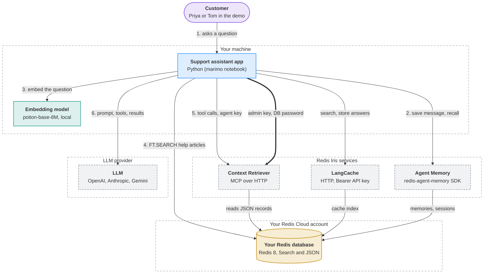
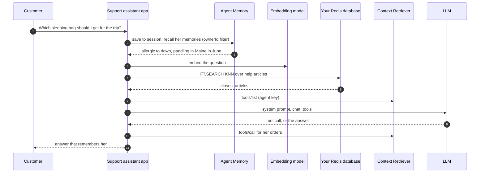
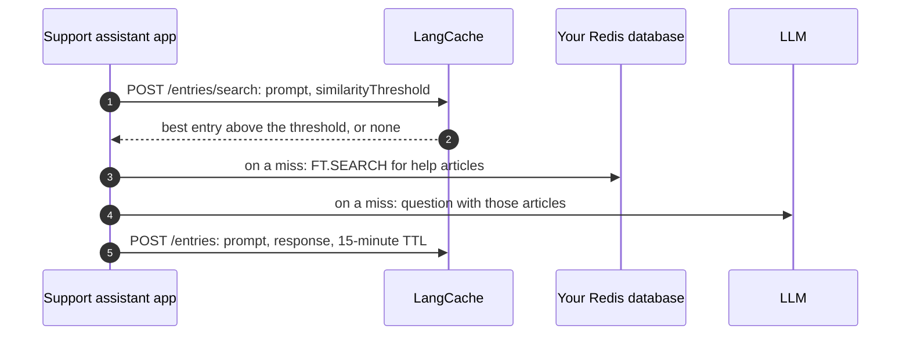
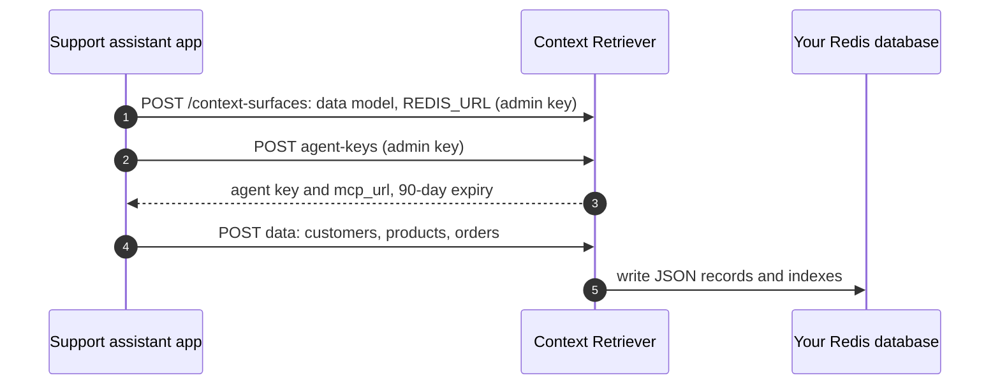

<!-- Generated by visualizer from architecture.json. Don't edit this file: edit the model, or rerun /visualizer:architecture. -->

# Redis Iris support assistant architecture

An AI support assistant for a made-up outdoor-gear shop, built on Redis Iris one layer at a time. The app embeds each question on your machine and finds the closest help articles with Redis Search in your own database. Three hosted Iris services add to it: LangCache reuses answers to questions asked in other words, Context Retriever gives the model tools over the shop's JSON records, and Agent Memory keeps what each customer said. The LLM writes every answer from the context the app assembles.

**Highlights**

- Every credential comes from `.env`: `REDIS_URL`, `LLM_API_KEY`, `LANGCACHE_API_KEY`, `CTX_ADMIN_KEY`, and `MEMORY_API_KEY`.
- Creating a Context Retriever surface sends the database password from `REDIS_URL` to the hosted service, which keeps it until the surface is deleted.
- The admin key only creates and deletes surfaces. Tool calls carry a separate agent key, which expires after 90 days.
- The app's own Redis data expires: help articles and shop records after an hour, cached answers after 15 minutes.
- Customers are kept apart by id: Agent Memory filters on `ownerId` before it ranks by meaning.

## Overview

| Shape | Colour | Meaning |
|---|---|---|
| Rounded box | purple | Client: a person or app that uses the system |
| Box | blue | Service you run |
| Box | teal | Module inside a program |
| Cylinder | yellow | Datastore: where state lives |
| Dashed box | grey | External system you don't run |
| Dashed outline | — | Trust or deployment boundary |
| Solid arrow | — | Call or request |
| Thick arrow | — | Sign-in or credential flow |
| 1. 2. 3. before a label | — | The main path, in order |

## Components

| Component | Kind | Runs in | Responsibility | Evidence |
|---|---|---|---|---|
| **Customer** Priya or Tom in the demo | client | — | Asks the support assistant about products, care, and their own orders. | [`src/cairn_support/sample_data.py`](../../src/cairn_support/sample_data.py) |
| **Support assistant app** Python (marimo notebook) | service | Your machine | Assembles each answer's context from search, cache, tools, and memory, and asks the LLM to write it. | [`notebooks/learn_iris_101.py`](../../notebooks/learn_iris_101.py), [`src/cairn_support/`](../../src/cairn_support/) |
| **Embedding model** potion-base-8M, local | module | Your machine | Turns questions and articles into 256-number vectors on your machine, with no API call. | [`src/cairn_support/embedder.py`](../../src/cairn_support/embedder.py) |
| **Your Redis database** Redis 8, Search and JSON | datastore | Your Redis Cloud account | Holds the help center index and the shop's JSON records, and backs the Iris services' indexes. | [`notebooks/learn_iris_101.py`](../../notebooks/learn_iris_101.py), [`src/cairn_support/redis_search_replies.py`](../../src/cairn_support/redis_search_replies.py) |
| **LangCache** HTTP, Bearer API key | external | Redis Iris services | Semantic cache: returns a stored answer when a new question means the same thing. | [`notebooks/learn_iris_101.py`](../../notebooks/learn_iris_101.py) |
| **Context Retriever** MCP over HTTP | external | Redis Iris services | Turns a declared data model into tools and answers each tool call from the JSON records. | [`notebooks/learn_iris_101.py`](../../notebooks/learn_iris_101.py) |
| **Agent Memory** redis-agent-memory SDK | external | Redis Iris services | Keeps each chat as session memory and recalls each customer's long-term memories by meaning. | [`notebooks/learn_iris_101.py`](../../notebooks/learn_iris_101.py), [`pyproject.toml`](../../pyproject.toml) |
| **LLM** OpenAI, Anthropic, Gemini | external | LLM provider | Writes each answer from the prompt the app assembles, calling tools when it needs records. | [`src/cairn_support/llm.py`](../../src/cairn_support/llm.py) |

## Where state lives

| Store | Runs in | Holds | Lifetime | Reached by |
|---|---|---|---|---|
| **Your Redis database** | Your Redis Cloud account | Help articles with vectors (hashes) | 1 hour | Support assistant app, Context Retriever, LangCache, Agent Memory |
| **Your Redis database** | Your Redis Cloud account | Customers, products, orders (JSON) | 1 hour | Support assistant app, Context Retriever, LangCache, Agent Memory |
| **Your Redis database** | Your Redis Cloud account | LangCache and Agent Memory indexes | managed by each service | Support assistant app, Context Retriever, LangCache, Agent Memory |

## Flows

### One support turn

Priya asks a question in a new chat (Chapter 4). Every layer adds to what the model sees.

### Cache-aside answer

A care question everyone asks (Chapter 2). A hit skips the model; a miss stores the new answer.

### Creating a Context Retriever surface

Run once before tool calls (Chapter 3). This is where the database password leaves your machine.

## Notes

Kept exactly as written. They steer what the diagram includes.

> Generalized Redis Iris reference architecture for an AI support assistant, not the notebook's internals. Show: the app (the support assistant), the customer, the LLM provider (OpenAI, Anthropic, or Gemini), a local embedding model, the user's Redis database (Search + JSON), and the three hosted Redis Iris services: LangCache (semantic cache over HTTP), Context Retriever (tools over MCP, reads JSON records from the user's Redis), and Agent Memory (session + long-term memory). Show which credentials go where (.env keys) and where state lives. Keep it to one clear overview diagram plus a short README overview; skip marimo cells, cairn_support helper modules, and tests. Do not overwrite or reorder existing README sections; add the overview in a single new section.
>
> Added 2026-10-26

---

Generated by visualizer from [`architecture.json`](architecture.json). Model as of commit `b935b88` (2026-10-26). Content hash `d8ddf086a840`.
